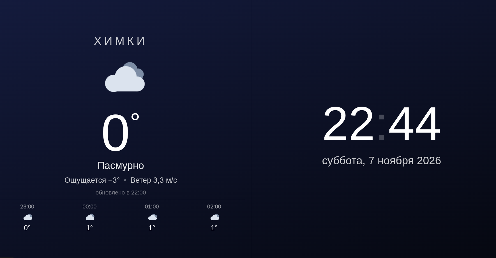

# HomeDashboard

Нашлось применение старому IPad!



Одностраничный дашборд для iPad 2 (iOS 9.3.5, 1024×768): погода + часы.
Левая половина — погода в настроенной локации (иконка солнце/облака/дождь/снег,
температура, «ощущается», ветер, почасовой прогноз на 4 часа), правая — часы
и дата. Днём и ночью разные фоны; ночью вместо солнца — луна.

## Запуск

```bash
docker compose up -d --build
```

Если ругается на `docker.sock` (настроен Docker Desktop, но он не запущен) —
переключиться на системный демон: `docker context use default`.

Сервер слушает порт **80**. Дашборд уже в сети: контейнер `home-dashboard`,
`restart: unless-stopped` (переживает перезагрузку компьютера).

## Настройка (config.json)

```json
{
  "server_ip": "0.0.0.0",
  "location": {"name": "Москва", "lat": 55.7558, "lon": 37.6173},
  "refresh_sec": 600
}
```

- `location` — за что показывать погоду: `name` (подпись города на экране)
  и координаты в десятичных градусах (можно посмотреть в Яндекс.Картах:
  правый клик по точке → «Что здесь?»).
- `refresh_sec` — как часто обновлять погоду, в секундах (минимум 60).
- `server_ip` — оставьте `0.0.0.0`: дашборд доступен по любому IP компьютера.
  Если IP компьютера изменится, здесь ничего менять не нужно — только закладку
  на iPad.

Файл смонтирован в контейнер, пересборка не требуется — после правки:

```bash
docker restart home-dashboard
```

## Настройка iPad

1. Открыть в **Safari**: `<IP>` (IP этого компьютера).
   Полноэкранный режим возможен только из Safari.
2. «Поделиться» → **«На экран "Домой"»** → запускать дашборд этой иконкой —
   откроется на весь экран без браузерной рамки.
3. Настройки iPad → «Основные» → «Автоблокировка» → **«Никогда»**, иначе
   экран будет гаснуть.

## Как устроено

- `server.py` — Python 3, только стандартная библиотека. С периодом
  `refresh_sec` (по умолчанию раз в 10 минут) берёт погоду из MET Norway
  (api.met.no — бесплатно, без ключа, доступен из РФ), кэширует в памяти
  и отдаёт:
  - `GET /` — единственная страница (CSS/JS/SVG инлайн, внешних запросов нет);
  - `GET /api/weather` — JSON `{city, refresh, lat, lon, temp, feels, wind,
    icon, desc, is_day, updated, fetched, forecast}`. При сбое сети отдаётся
    последний удачный кэш (`fetched` — epoch последнего удачного обновления,
    стареет вместе с кэшем).
- `index.html` — страница под WebKit iOS 9: JS строго ES5 (XHR вместо fetch),
  CSS с `-webkit-` префиксами, раскладка на table-cell, анимации иконок только
  на transform/opacity. Погода опрашивается раз в минуту, часы идут локально.
  Если данных нет дольше `refresh_sec` + 2 минуты (обрыв у iPad или сбой
  обновления на сервере), надпись «обновлено в …» мигает красным. При
  восстановлении связи после обрыва страница перезагружается сама
  (подтягивается свежая версия).
- `config.json` — настройки (см. выше).
- `Dockerfile` / `docker-compose.yml` — образ `python:3.12-alpine`, один контейнер.
